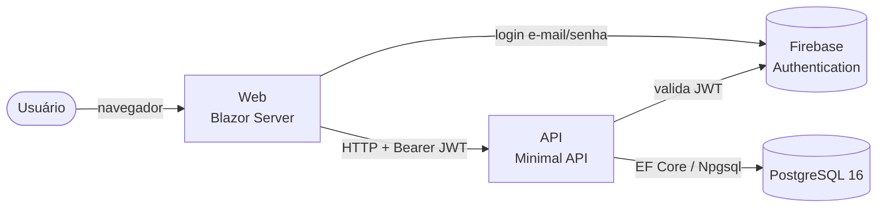

# SinterPrints — Documentação de Referência

O **SinterPrints** é um sistema de catálogo e controle de **arquivos de arte final** criados em ferramentas como CorelDRAW, Photoshop, Illustrator, Inkscape e similares. Ele substitui a busca manual em pastas, HDs e disquetes por um cadastro pesquisável: cada trabalho vira uma **ficha** com nome, cliente, tipo de arquivo, data, número do arquivo e número do disquete onde está guardado.

> Para uma visão rápida e visual, veja o infográfico [SinterPrints — Visão Geral](https://claude.ai/artifact/9nvQhAX4C4cag2oHSeAnNo): 5 quadros (o que é, jornada do usuário, arquitetura, dados, qualidade e entrega). O link é privado até ser compartilhado pelo menu Share.

## Para quem é esta documentação

| Você é... | Comece por |
| --- | --- |
| Usuário do sistema (cadastro e busca de fichas) | [Guia do Usuário](user-guide.md) |
| Desenvolvedor chegando no projeto | [Desenvolvimento local](development.md) → [Arquitetura](architecture.md) |
| Quem vai integrar com a API | [Referência da API](api-reference.md) |
| Quem cuida de servidor e deploy | [Deploy e operação](deployment.md) |

## Índice

1. [Guia do Usuário](user-guide.md) — login, listagem, busca, ordenação, cadastro, edição e exclusão de fichas.
2. [Arquitetura](architecture.md) — projetos da solution, dependências, fluxo de uma requisição.
3. [Modelo de Domínio](domain-model.md) — entidade `FileRecord`, enum `FileType`, regras de validação.
4. [Referência da API](api-reference.md) — endpoints, parâmetros, respostas e erros.
5. [Frontend Web (Blazor)](web-ui.md) — páginas, rotas, serviços e interop JavaScript.
6. [Dados e Migrations](data-and-migrations.md) — PostgreSQL, convenções, histórico de migrations, import legado GHL.
7. [Autenticação e Segurança](auth-and-security.md) — Firebase, ciclo de vida do token, configuração de secrets.
8. [Desenvolvimento Local](development.md) — pré-requisitos, setup, comandos `make`.
9. [Testes](testing.md) — estratégia, projetos de teste, como rodar.
10. [Deploy e Operação](deployment.md) — CI/CD, Docker Compose, VPS, troubleshooting.

Documentos complementares já existentes:

- [`docs/firebase-setup.md`](../firebase-setup.md) — passo a passo da configuração do Firebase em desenvolvimento.
- [`docs/ghl-registros2-import.md`](../ghl-registros2-import.md) — import manual do dump legado `ghl_registros2`.
- [`deploy/README.md`](../../deploy/README.md) — preparação da VPS.

## O sistema em uma página

**Funcionalidades implementadas**

- Login com e-mail e senha (Firebase Authentication), com renovação automática do token.
- Listagem paginada de fichas com rolagem infinita (50 por página).
- Busca por nome ou cliente, sem diferenciar maiúsculas/minúsculas nem acentos, com múltiplos termos.
- Ordenação por qualquer coluna, feita no servidor.
- Seletor de colunas visíveis e layout em cards no celular.
- Cadastro, edição e exclusão de fichas, com validação no cliente e na API.
- Página de health check da API e do banco.

**Planejado (ainda não implementado)**

- Catálogo visual com preview/thumbnail.
- Tags e categorias personalizáveis.
- Controle de versões dos arquivos.
- Busca avançada por período (data inicial/final).

## Stack

| Camada | Tecnologia |
| --- | --- |
| Runtime | .NET 10 |
| Frontend | Blazor Server (Interactive Server) |
| API | ASP.NET Core Minimal APIs |
| Dados | EF Core 10 + Npgsql + EFCore.NamingConventions (snake_case) |
| Banco | PostgreSQL 16 (extensão `unaccent`) |
| Autenticação | Firebase Authentication (REST + JWT Bearer) |
| Testes | xUnit, FsCheck, bUnit, NSubstitute, WebApplicationFactory, Testcontainers |
| Infra | Docker (Alpine), Docker Compose, Caddy, GitHub Actions |
