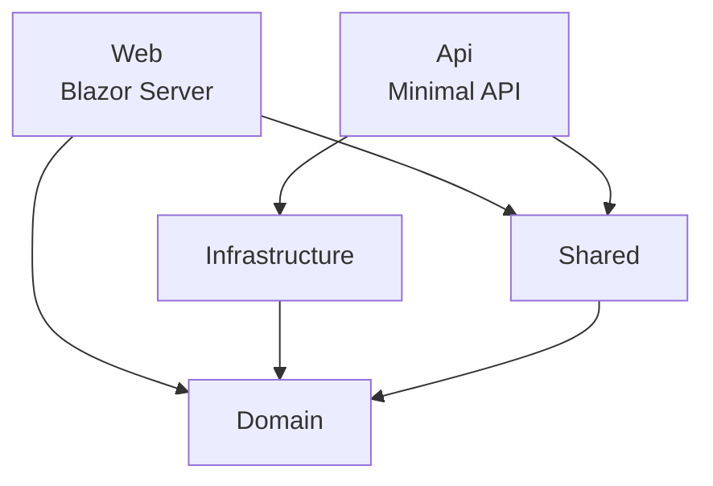
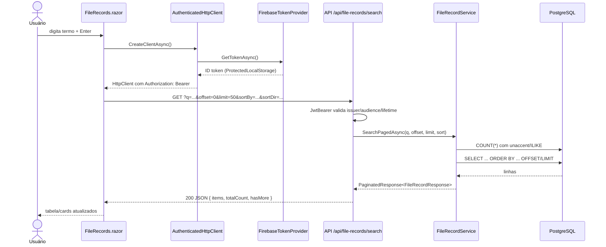
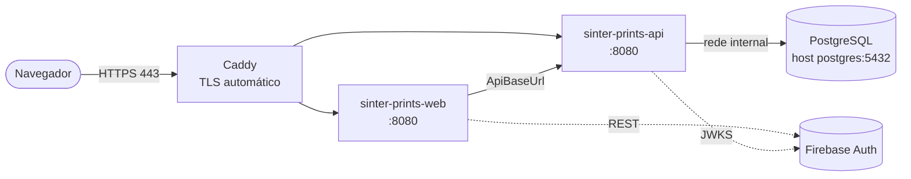

# Arquitetura

O SinterPrints é um mono-repo .NET 10 com dois processos executáveis, **Web** e **API**, que compartilham bibliotecas de domínio e contratos. A estrutura é deliberadamente simples: sem camadas extras, convenção sobre configuração.

## Projetos da solution

| Projeto | Tipo | Responsabilidade |
| --- | --- | --- |
| `src/Domain` | Biblioteca | Entidade `FileRecord` e enum `FileType`. Sem dependências. |
| `src/Shared` | Biblioteca | DTOs (`CreateFileRecordRequest`, `UpdateFileRecordRequest`, `FileRecordResponse`, `PaginatedResponse<T>`, `HealthCheckResponse`) e atributos de validação (`NotWhiteSpace`, `NotDefaultDateTime`). |
| `src/Infrastructure` | Biblioteca | `AppDbContext` (EF Core + Npgsql + snake_case), migrations, inicialização do Firebase Admin SDK, `AddInfrastructure()` para DI. |
| `src/Api` | ASP.NET Core (Minimal APIs) | Endpoints REST, validação via endpoint filter, `FileRecordService` (consultas, busca, ordenação), autenticação JWT do Firebase. |
| `src/Web` | Blazor Server | Interface do usuário, login no Firebase via REST, armazenamento protegido de tokens, chamadas autenticadas à API. |

## Grafo de dependências

O **Web não referencia Infrastructure**: ele não acessa o banco. Todo dado passa pela API via HTTP. O `Dockerfile.Web` copia apenas `Domain`, `Shared` e `Web`.

## Fluxo de uma requisição (busca de fichas)

## Decisões de design

- **Minimal APIs, sem Controllers.** Endpoints agrupados em `MapGroup("/api/file-records")` com `RequireAuthorization("Authenticated")`.
- **Validação por endpoint filter.** `ValidationFilter<T>` lê os atributos dos parâmetros do construtor dos `record` DTOs, porque `Validator.TryValidateObject` não os enxerga nas propriedades. Responde `400 { errors: [...] }`.
- **Busca em SQL bruto parametrizado.** A busca usa `unaccent(lower(...)) ILIKE` com `NpgsqlParameter`. A ordenação dinâmica só aceita campos de uma whitelist (`ValidSortFields`), o que evita SQL injection no `ORDER BY`.
- **Paginação estável.** Toda ordenação recebe `id` como critério de desempate.
- **Migrations automáticas só em produção.** `Program.cs` da API roda `MigrateAsync()` quando `IsProduction()`. Em desenvolvimento, use `make migrate`.
- **Blazor Server com token no navegador.** O ID token e o refresh token do Firebase ficam em `ProtectedLocalStorage`, criptografados pelo Data Protection. Em produção, as chaves são persistidas em volume para que a sessão sobreviva a redeploys.

## Topologia em produção

Detalhes em [Deploy e Operação](deployment.md).
