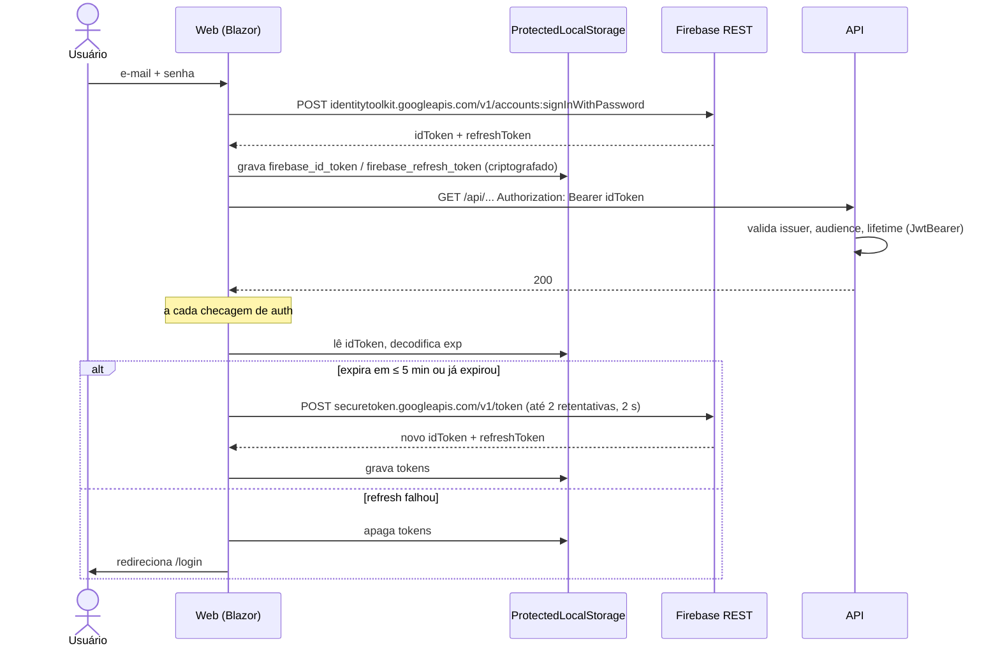

# Autenticação e Segurança

O Firebase Authentication é a fonte de verdade de identidade. O sistema não guarda senhas.

## Visão geral



## Lado Web

| Componente | Detalhe |
| --- | --- |
| `FirebaseTokenProvider` | `SignInAsync` (timeout HTTP de 15 s), `RefreshTokenAsync` (`RefreshMaxRetries = 2`, `RefreshRetryDelayMs = 2000`), `SignOutAsync` (apaga as duas chaves). |
| `FirebaseAuthStateProvider` | Fornece o `AuthenticationState`. Durante o prerender (sem JS interop), retorna anônimo. `RefreshWindowMinutes = 5`. |
| `ProtectedLocalStorage` | Tokens criptografados com ASP.NET Data Protection. |
| Data Protection | Em produção, as chaves são persistidas em `DataProtection:KeyPath` (`/keys`, volume `web-dataprotection-keys`), com `SetApplicationName("SinterPrintsWeb")`. Sem isso, cada redeploy invalidaria os tokens e forçaria novo login. |

Mapeamento de erros do Firebase (mostrados na tela de login):

| Código Firebase | Mensagem |
| --- | --- |
| `EMAIL_NOT_FOUND`, `INVALID_PASSWORD`, `INVALID_LOGIN_CREDENTIALS` | Email ou senha incorretos. |
| `USER_DISABLED` | Sua conta está desativada. Contate o administrador. |
| `TOO_MANY_ATTEMPTS_TRY_LATER` | Muitas tentativas. Tente novamente mais tarde. |
| outros | Erro ao autenticar. Tente novamente. |

## Lado API

Configurado em `src/Api/Program.cs`:

```csharp
options.Authority = $"https://securetoken.google.com/{projectId}";
ValidIssuer   = $"https://securetoken.google.com/{projectId}";
ValidAudience = projectId;
ValidateLifetime = true;
ClockSkew = TimeSpan.FromMinutes(5);
```

- Policy `Authenticated` (`RequireAuthenticatedUser`) aplicada ao grupo `/api/file-records` e a `/api/me`.
- `OnChallenge` customizado devolve `401` em JSON com `missing_token`, `invalid_token` ou `token_expired`.
- Na inicialização, `FirebaseInitializer` (Infrastructure) valida `Firebase:ServiceAccountPath` (configurado e arquivo existente) e inicializa o Firebase Admin SDK. Falha cedo com mensagem clara.
- `Firebase:ProjectId` ausente → `InvalidOperationException` na inicialização.

## Configuração e secrets

| Chave | Projeto | Dev | Produção |
| --- | --- | --- | --- |
| `Firebase:ProjectId` | Api | User Secrets | `Firebase__ProjectId` (compose) |
| `Firebase:ServiceAccountPath` | Api | User Secrets (caminho fora do repo) | `/run/secrets/firebase-service-account.json` (volume read-only) |
| `Firebase:ApiKey` | Web | User Secrets | `.env` |
| `ConnectionStrings:DefaultConnection` | Api | `appsettings.Development.json` (credencial dev) | env com `${POSTGRES_USER}`/`${POSTGRES_PASSWORD}` do `.env` |

Passo a passo: [`docs/firebase-setup.md`](../firebase-setup.md).

## Boas práticas de segurança adotadas

- Nenhum secret no repositório. Service account e `.env` ficam fora do git.
- SQL de busca 100% parametrizado (`NpgsqlParameter`) e `ORDER BY` restrito a whitelist.
- Limite de tamanho no termo de busca (200) e nos campos (200).
- Containers rodando como usuário não-root (`appuser`).
- TLS terminado pelo Caddy; o Web confia em `X-Forwarded-For`/`X-Forwarded-Proto`.
- Testes de propriedade cobrem tokens malformados, issuer/audience inválidos, clock skew, extração de claims e configuração ausente (veja [Testes](testing.md)).
