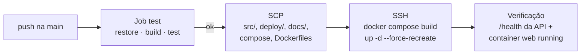

# Deploy e Operação

Deploy contínuo para uma VPS via **GitHub Actions + SSH + Docker Compose**. O build das imagens acontece na própria VPS.

## Pipeline



Arquivo: `.github/workflows/deploy.yml`. Secret necessário: `VPS_SSH_KEY`.

## Containers (`docker-compose.prod.yml`)

| Serviço | Imagem | Porta | Redes | Observações |
| --- | --- | --- | --- | --- |
| `api` (`sinter-prints-api`) | `Dockerfile.Api` (aspnet 10 Alpine) | 8080 | `proxy`, `internal` | Service account do Firebase montada read-only. Aplica migrations ao iniciar. |
| `web` (`sinter-prints-web`) | `Dockerfile.Web` (aspnet 10 Alpine) | 8080 | `proxy` | Volume `web-dataprotection-keys` em `/keys`. `ApiBaseUrl` vindo do `.env`. |

- As redes `proxy` e `internal` são **externas** e precisam existir na VPS. O PostgreSQL é acessado pelo host `postgres` na rede `internal`.
- Ambas as imagens: build multi-stage, usuário não-root, ICU habilitado (globalização) e `HEALTHCHECK` em `/health`.
- O Caddy termina o TLS (443, certificado automático) e faz o proxy para os containers.

## Variáveis de ambiente (`.env` na VPS)

| Variável | Uso |
| --- | --- |
| `POSTGRES_USER`, `POSTGRES_PASSWORD` | Connection string da API. |
| `API_BASE_URL` | URL que o Web usa para chamar a API. |
| `Firebase__ApiKey` | Web API key (Web). O compose carrega o `.env` via `env_file`. |

Também é preciso colocar o arquivo da service account em `./secrets/firebase/service-account.json`, no diretório da aplicação.

Preparação da VPS (diretório, Caddy, chave SSH): [`deploy/README.md`](../../deploy/README.md).

## Operação

```bash
cd /opt/apps/sinter-prints
docker compose -f docker-compose.prod.yml ps
docker compose -f docker-compose.prod.yml logs -f api
docker compose -f docker-compose.prod.yml restart web
docker exec sinter-prints-api wget -qO- http://localhost:8080/health
```

## Troubleshooting

| Sintoma | Causa provável | Ação |
| --- | --- | --- |
| API não sobe: "`Firebase:ProjectId` is missing" | Variável ausente. | Conferir o compose/`.env`. |
| API não sobe: "service account file not found" | Volume da service account ausente. | Conferir `./secrets/firebase/service-account.json`. |
| `/health` retorna `Unhealthy` | Banco inacessível. | Conferir a rede `internal`, o container do PostgreSQL e as credenciais. |
| Todos deslogados após deploy | Chaves do Data Protection perdidas. | Conferir o volume `web-dataprotection-keys` e `DataProtection__KeyPath`. |
| Web carrega mas a lista dá erro | `API_BASE_URL` errada. | Conferir o `.env` e testar `/health` da API. |
| Migration falhou no start | Dados incompatíveis. | Ver `logs api` e restaurar o backup antes de tentar de novo. |
