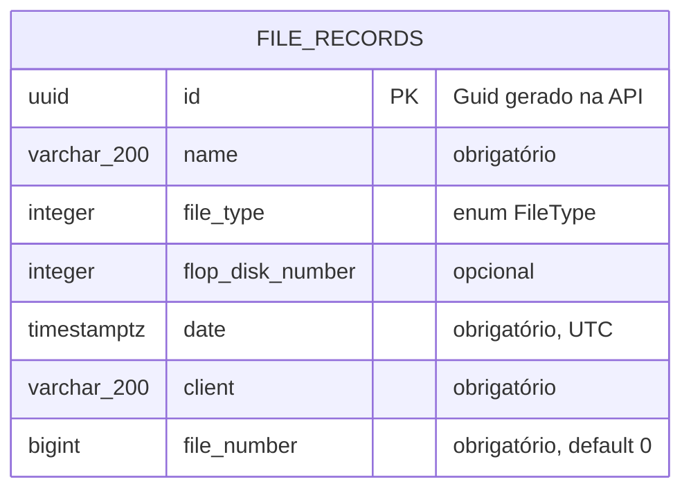

# Modelo de Domínio

O domínio atual tem uma única entidade: `FileRecord` (ficha de arquivo).

## Entidade `FileRecord`

Arquivo: `src/Domain/Entities/FileRecord.cs` · Tabela: `public.file_records`



| Propriedade C# | Coluna | Tipo PostgreSQL | Nulo? | Regras |
| --- | --- | --- | --- | --- |
| `Id` (`Guid`) | `id` | `uuid` | Não | PK `pk_file_records`, gerado com `Guid.NewGuid()` na criação. |
| `Name` (`string`) | `name` | `varchar(200)` | Não | Trim ao salvar. |
| `FileType` (`FileType`) | `file_type` | `integer` | Não | Valor do enum. |
| `FlopDiskNumber` (`int?`) | `flop_disk_number` | `integer` | Sim | Número da mídia física. |
| `Date` (`DateTime`) | `date` | `timestamptz` | Não | Gravado com `DateTimeKind.Utc`. Registros legados sem data usam o sentinela `1900-01-01`. |
| `Client` (`string`) | `client` | `varchar(200)` | Não | Trim ao salvar. |
| `FileNumber` (`long`) | `file_number` | `bigint` | Não | 0 a 99.999.999.999. `0` = sem número (legado). |

## Enum `FileType`

Arquivo: `src/Domain/Enums/FileType.cs`. Persistido como inteiro. **Não reordene os valores**: o banco guarda o número.

| Valor | Nome | Valor | Nome |
| --- | --- | --- | --- |
| 0 | CorelDRAW | 7 | PageMaker |
| 1 | Photoshop | 8 | JPEG |
| 2 | Illustrator | 9 | PNG |
| 3 | Inkscape | 10 | TIFF |
| 4 | PDF | 11 | EPS |
| 5 | Other | 12 | LegacyOld |
| 6 | InDesign | 13 | Unknown |

`Unknown` é usado para registros legados com tipo vazio; `Other`, para tipos legados não mapeados.

## Validação (DTOs de entrada)

`CreateFileRecordRequest` e `UpdateFileRecordRequest` (`src/Shared/Dtos/`) têm as mesmas regras. As mensagens estão em pt-BR e voltam ao cliente no `400`.

| Campo | Regras | Mensagem |
| --- | --- | --- |
| `Name` | `Required`, `MinLength(1)`, `MaxLength(200)`, `NotWhiteSpace` | "O nome é obrigatório." / "O nome não pode ser vazio." / "O nome não pode exceder 200 caracteres." |
| `FileType` | `Required`, `EnumDataType(FileType)` | "Tipo de arquivo inválido." |
| `FlopDiskNumber` | — | — |
| `Date` | `NotDefaultDateTime` | "A data é obrigatória." |
| `Client` | `Required`, `MinLength(1)`, `MaxLength(200)`, `NotWhiteSpace` | "O cliente é obrigatório." / "O cliente não pode ser vazio." / ... |
| `FileNumber` | `Range(0, 99_999_999_999)`, default `0` | "O número do arquivo deve ser um inteiro entre 0 e 99999999999." |

**Por que `NotDefaultDateTime`?** `[Required]` não tem efeito em `DateTime` não-nulável. Um JSON sem `date` vira `0001-01-01` silenciosamente. O atributo rejeita esse valor default.

## Resposta (`FileRecordResponse`)

```json
{
  "id": "3f1c...",
  "name": "Logo Empresa XYZ",
  "fileType": 0,
  "flopDiskNumber": 12,
  "date": "2024-03-10T00:00:00Z",
  "client": "Empresa XYZ",
  "fileNumber": 1179
}
```

`fileType` é serializado como número (serialização padrão do System.Text.Json).
