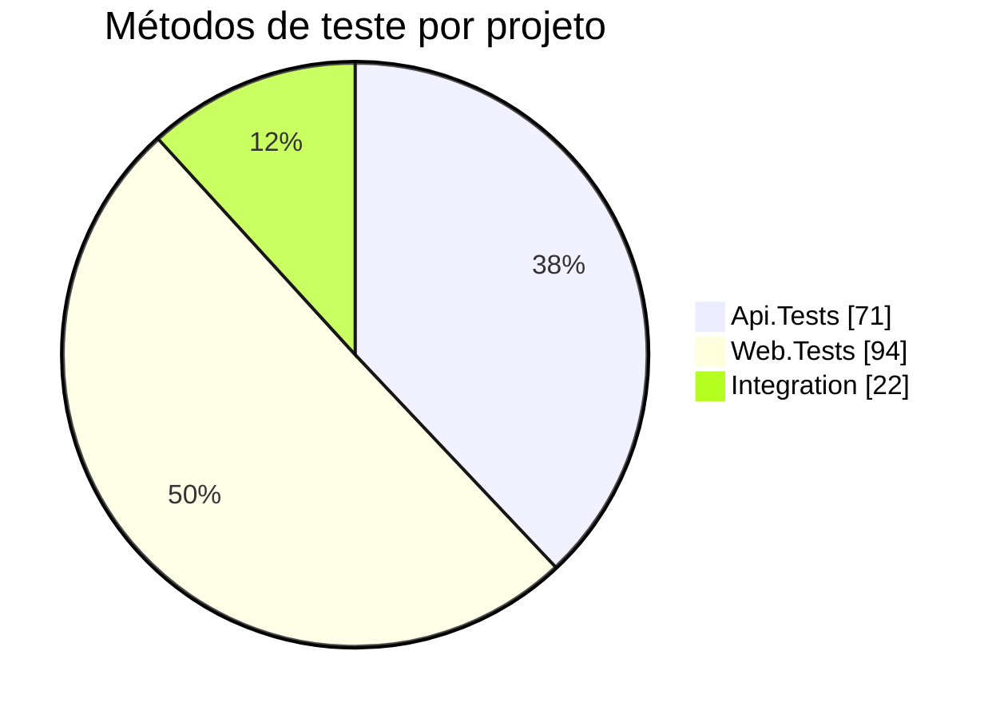

# Testes

Três projetos de teste, com **187 métodos de teste** (`[Fact]`, `[Theory]`, `[Property]`) no total, combinando testes de exemplo e testes baseados em propriedades (FsCheck).

| Projeto | Métodos | Ferramentas | Foco |
| --- | --- | --- | --- |
| `tests/Api.Tests` | 71 | xUnit, FsCheck, `WebApplicationFactory`, EF InMemory | Endpoints, validação, busca, ordenação, autenticação JWT, configuração de startup. |
| `tests/Web.Tests` | 94 | xUnit, bUnit, NSubstitute, FsCheck | Componentes (Login, FileRecords), visibilidade de colunas, token provider, refresh. |
| `tests/Integration` | 22 | xUnit, Testcontainers PostgreSQL | Busca (`unaccent`/`ILIKE`) e ordenação contra PostgreSQL real. |



## Como rodar

```bash
make test                                   # tudo
dotnet test tests/Api.Tests                 # um projeto
dotnet test --filter "FullyQualifiedName~Sort"
dotnet test --collect:"XPlat Code Coverage" # cobertura (coverlet)
```

`tests/Integration` exige **Docker rodando** (sobe um container PostgreSQL por fixture).

## Infra de teste

- **`CustomWebApplicationFactory`** (`Api.Tests`): troca o `AppDbContext` por EF InMemory, com nome de banco único por factory para evitar estado compartilhado. Troca a autenticação por `TestAuthHandler`.
- **Integration**: `WebApplicationFactory` apontando para um container `Testcontainers.PostgreSql`, com migrations reais (`postgres:16-alpine`). Valida o SQL bruto que o InMemory não executa (`unaccent`, `ILIKE`, `NULLS FIRST/LAST`).
- **bUnit + NSubstitute**: `ITokenProvider`, `ITokenStorage` e `HttpClient` são mockados para testar componentes isolados.

## Cobertura por tema

| Tema | Arquivos de exemplo |
| --- | --- |
| Autenticação JWT | `AudienceIssuerValidationPropertyTests`, `ClockSkewBoundaryPropertyTests`, `MalformedTokenRejectionPropertyTests`, `JwtClaimExtractionPropertyTests`, `AuthenticatedPolicyPropertyTests` |
| Startup/config | `MissingConfigurationKeyPropertyTests`, `StartupCredentialFileValidationPropertyTests` |
| CRUD/validação | `FileRecordEndpointTests`, `FileRecordPropertyTests`, `ExcessiveInputLengthPropertyTests` |
| Busca | `FileRecordSearchTests`, `FileRecordSearchPropertyTests`, `FileRecordSearchIntegrationTests`, `FileRecordsSearchTests` (bUnit) |
| Ordenação | `FileRecordSortTests`, `FileRecordSortPropertyTests`, `FileRecordSortIntegrationTests`, `FileRecordsSortTests` (bUnit) |
| Colunas | `ColumnVisibility*PropertyTests`, `FileRecordsColumnVisibilityTests` |
| Login/token | `LoginComponentTests`, `LoginIntegrationTests`, `Login*PropertyTests`, `FirebaseTokenProviderTests`, `TokenRefreshTimingPropertyTests`, `FirebaseErrorCodeMappingPropertyTests` |

## Convenções

- Nome: `MetodoSobTeste_Cenario_ResultadoEsperado`; classes terminam em `Tests` ou `PropertyTests`.
- Arrange / Act / Assert.
- Testes independentes, sem ordem nem estado compartilhado.
- Mudança em SQL bruto → teste em `Integration`.

## CI

O GitHub Actions (`.github/workflows/deploy.yml`) roda `dotnet restore`, `build` e `test` a cada push na `main`. O deploy só acontece se os testes passarem.
